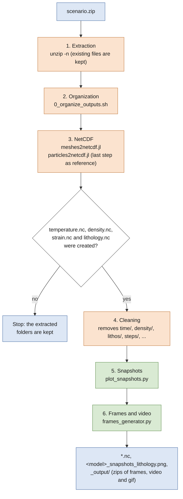

# Pipeline

`pipeline.sh` post-processes a scenario from its zip file in one command: it extracts the outputs of Mandyoc,
creates the `.nc` files with tapioca, removes the extracted folders and makes the snapshots and the video of the
scenario. The particle tracking and the P-T-t frames are not in the pipeline (see [Workflow](workflow.md)).

```
conda activate tapioca
bash ~/opt/post_processing/pipeline.sh /path/to/scenario/scenario.zip 14
```

The second argument is the number of Julia threads (default: `auto`). tapioca is read from `~/opt/tapioca`, or
from the variable `TAPIOCA_DIR`:

```
TAPIOCA_DIR=/other/path/tapioca bash ~/opt/post_processing/pipeline.sh scenario.zip
```



## Steps

1. **Extraction**: the zip is extracted in its folder, which is the folder of the scenario. Existing files are not
   overwritten (`unzip -n`).
2. **Organization**: `0_organize_outputs.sh` of tapioca moves the `*.txt` outputs to sub-folders (`time/`,
   `density/`, `lithos/`, `steps/`, ...). Zips made by `zipper.sh` have the files in the root; newer zips already
   have the sub-folders, and then this step does nothing.
3. **NetCDF**: `meshes2netcdf.jl` creates the mesh fields (`temperature.nc`, `density.nc`, `strain.nc`,
   `lithology.nc`, ...). If there is a `steps/` folder, `particles2netcdf.jl` creates `particles_trajectories.nc`
   with the last step as reference step, as the tracking scripts need.
4. **Cleaning**: if `temperature.nc`, `density.nc`, `strain.nc` and `lithology.nc` were created, the folders of the
   outputs are removed (`time/`, `density/`, `heat/`, `pressure/`, `surface/`, `strain_rate/`, `strain/`,
   `temperature/`, `viscosity/`, `velocity/`, `thermal_diffusivity/`, `X_depletion/`, `Phi/`, `dPhi/`, `lithos/`,
   `steps/`). Otherwise the pipeline stops and keeps them. The zip and the other files are kept.
5. **Snapshots**: `plot_snapshots.py` saves `<model>_snapshots_lithology.png`, see below.
6. **Frames and video**: `frames_generator.py` makes the frames of the lithology, the video and the gif in
   `_output/` (zipped, with `zip_files = True`).

`lithology.nc` is only created with `export_lithology = True` in `param.txt`.

## Snapshots (`plot_snapshots.py`)

Snapshots of the scenario to see its general evolution: one panel per instant, equally spaced from the first to
the last step (`n_snapshots = 4`: the beginning, two intermediate instants and the end). It is based on the
Geometries notebook, without the measurements of the crust, and plots with `plot_property`. It can also be run
alone, in the folder of the scenario:

```
python ~/opt/post_processing/plot_snapshots.py
```

| Variable | Meaning |
| --- | --- |
| `prop` | Field to plot (`lithology` by default). |
| `lithology_colors` | `'auto'` (default), `'double_keel'`, `'rifting'`, `'accordion'` or a list with one color per layer code. |
| `n_snapshots` | Number of panels (4 by default). |

## Colors of the lithology

`plot_snapshots.py` and `frames_generator.py` use `lithology_colors = 'auto'`: the colors are chosen from the
number of layers in `lithology.nc` (11: double keel, 7: rifting, 8: accordion, see `get_lithology_colors`). For
another number of layers, set `lithology_colors` in both scripts (a key of `LITHOLOGY_COLORS` or a list of
colors); otherwise the pipeline stops in step 5 with a message. The `.nc` files are already created then, so set
`lithology_colors` and run only the last two steps, in the folder of the scenario:

```
python ~/opt/post_processing/plot_snapshots.py
python ~/opt/post_processing/frames_generator.py
```
