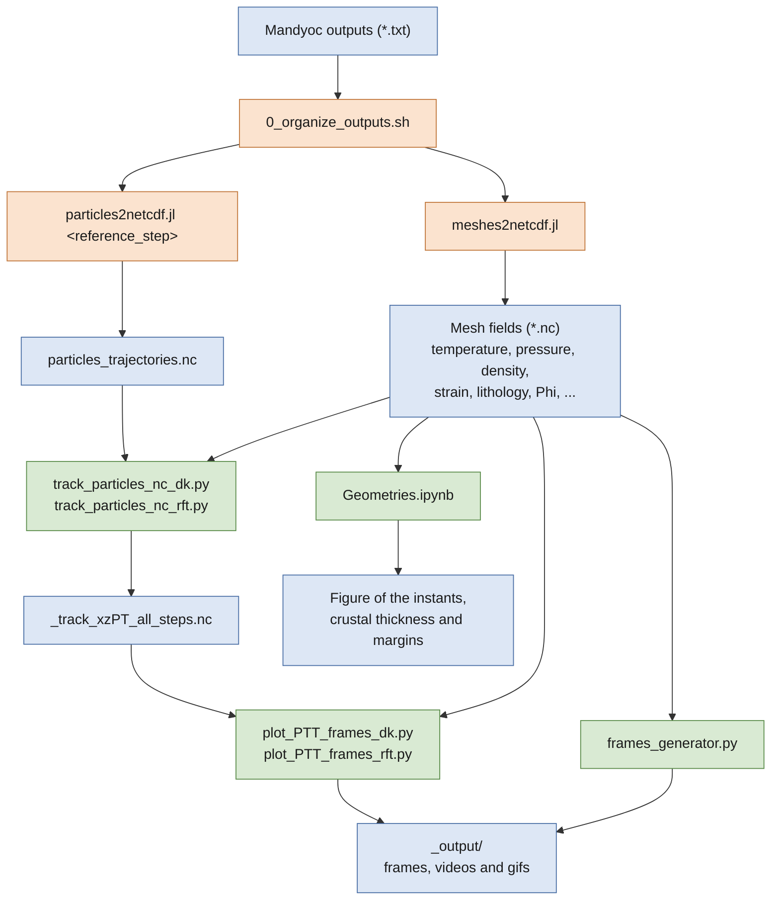

# Workflow

Every step runs in the folder of the scenario: the scripts read the `.nc` files from the current folder and write
their outputs there (`_track_xzPT_all_steps.nc`, `_output/`).



Orange: scripts of tapioca; green: scripts and notebook of this repository; blue: files.

`pipeline.sh` runs the steps 1, 2 and 4 (snapshots and video) from the zip of a scenario, see [Pipeline](pipeline.md).

## 1. Organize the outputs of Mandyoc

The Julia scripts of tapioca read the text files of Mandyoc organized in sub-folders (`time/`, `density/`,
`lithos/`, `steps/`, ...). Use `0_organize_outputs.sh` of tapioca (`src/postrunning/`) to move them.

## 2. Convert the outputs to NetCDF

```
julia -t 14 ~/opt/tapioca/src/postrunning/meshes2netcdf.jl ${PWD}
```

creates one file per field: `density.nc`, `temperature.nc`, `pressure.nc`, `strain.nc`, `strain_rate.nc`,
`viscosity.nc`, `heat.nc`, `velocity.nc`, and, depending on `param.txt`, `surface.nc` (surface tracking),
`Phi.nc`, `dPhi.nc`, `X_depletion.nc` (magmatism) and `lithology.nc` (`export_lithology = True`).

```
julia -t 14 ~/opt/tapioca/src/postrunning/particles2netcdf.jl ${PWD} <reference_step>
```

creates `particles_trajectories.nc`, with the trajectories of the particles that exist in `<reference_step>`.
The tracking scripts select particles in the final step of the tracking, so use that step as reference to have
all of them in the file (the scripts print a warning otherwise). The reference step must be given.

See [Data format](../references/data_format.md).

## 3. Track the particles

```
python ~/opt/post_processing/track_particles_nc_dk.py    # double keel models
python ~/opt/post_processing/track_particles_nc_rft.py   # rifting models
```

create `_track_xzPT_all_steps.nc`. See [Particle tracking](tracking.md).

## 4. Frames and videos

```
python ~/opt/post_processing/plot_PTT_frames_dk.py    # lithology + temperature-coded P-T-t paths
python ~/opt/post_processing/plot_PTT_frames_rft.py   # lithology + depth-coded P-T-t paths
python ~/opt/post_processing/frames_generator.py      # lithology, strain, isotherms and melt
```

create the frames, videos and gifs in `_output/`. See [Frames and videos](frames.md).

## 5. Geometries

Open `Geometries.ipynb` to plot a field at chosen instants and measure the crust. See
[Geometries notebook](geometries.md).
